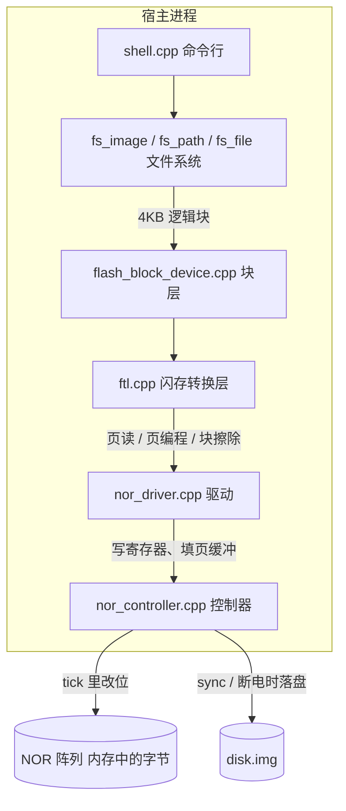
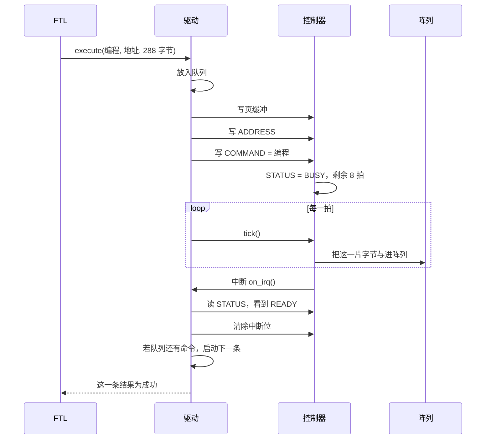
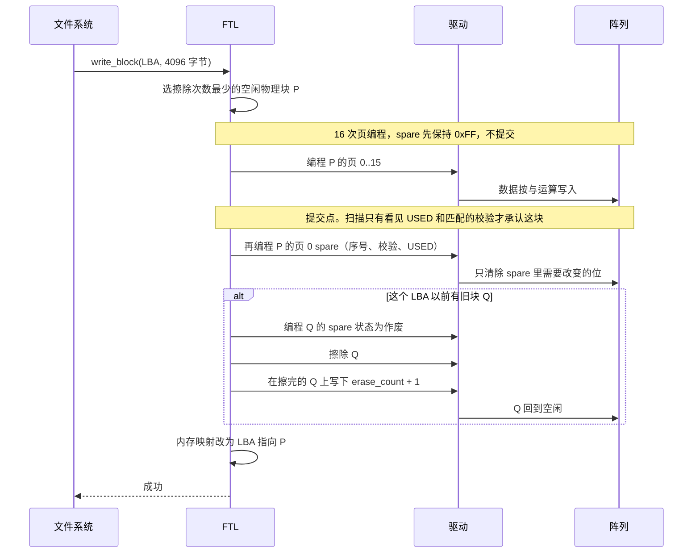
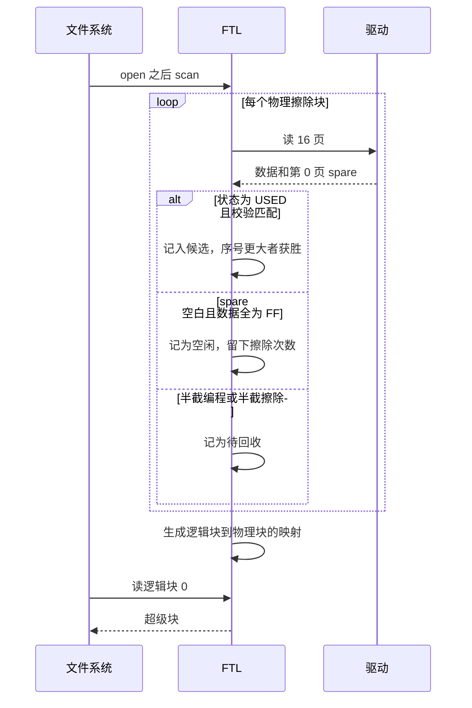
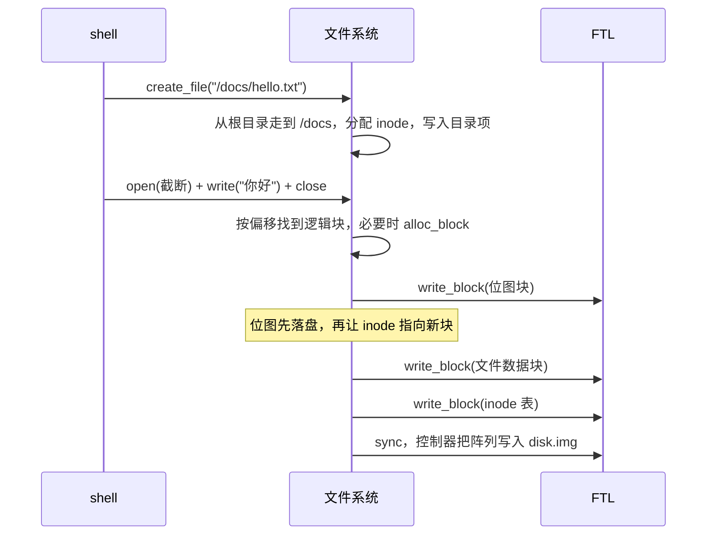
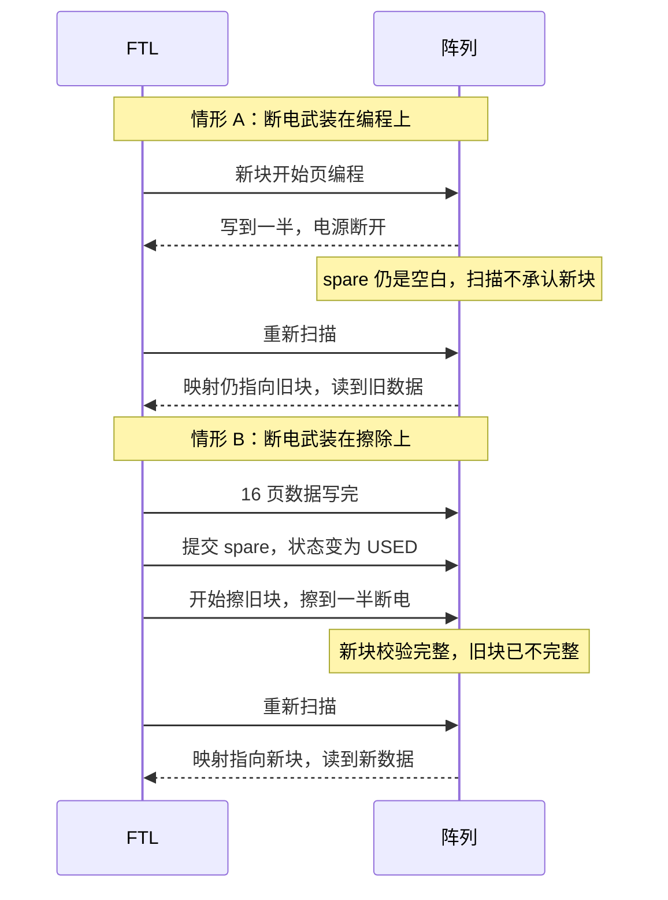

# minifs

这是一个可以在 Windows 上跑完的文件系统加存储系统。上面是目录和文件，下面是一块按真实规则工作的模拟 NOR 闪存：寄存器、驱动队列、中断、FTL。镜像文件 `disk.img` 保存的是闪存阵列。进程正常退出后再 `mount`，文件还在。自检还会在页编程和块擦除的中途切断电源。

逻辑盘默认 256 个 4KB 块（1 MiB）。闪存上有 512 个擦除块，多出来的一半用来做覆盖写。单个文件最大 48KB。

## 先跑起来

使用 CMake 和 Visual Studio 2019 x64。在 `D:\CppProject\minifs` 下执行：

```bat
cmake -S . -B build -G "Visual Studio 16 2019" -A x64
cmake --build build --config Release
build\Release\minifs.exe check
build\Release\minifs.exe
```

`ctest -C Release` 跑的是同一套自检。

```text
minifs> format
minifs> mkdir /docs
minifs> write /docs/hello.txt 你好
minifs> ls /docs
minifs> cat /docs/hello.txt
minifs> df
minifs> flash
minifs> exit
minifs> mount
minifs> cat /docs/hello.txt
```

`format` 创建 `disk.img` 并挂载。`format D:\data\disk.img 128` 指定路径和逻辑块数。文件系统路径以 `/` 开头，命令行参数不要带空格。`flash` 打印页读取、页编程、块擦除、中断和磨损次数。覆盖写同一个文件之后，擦除次数会增加。`exit` 会把阵列写回镜像。

## 总架构



调用方向只有从上到下。文件系统的源文件不包含 `nor_controller.hpp` 或 `ftl.hpp`，它只拿着 `BlockDevice` 接口。块层是唯一知道“下面是闪存”的接口实现。

| 层 | 代码 | 这一层回答的问题 | 真实系统里的对应物 |
| --- | --- | --- | --- |
| 命令行 | `src/shell.cpp` | 人输入 `write /docs/a.txt` | 应用程序、shell |
| 文件系统 | `src/fs_*.cpp` | 路径、inode、目录项、文件字节落在哪个逻辑块 | ext2 / ext4 这类块文件系统 |
| 块层 | `src/block/flash_block_device.cpp` | 把一次 4KB 读写交给 FTL，并负责把控制器时钟往前拨 | Linux 的块层，或 MCU 上的 disk 适配层 |
| FTL | `src/ftl/ftl.cpp` | 逻辑块号变成哪个物理擦除块；磨损；掉电后哪一版算数 | U 盘、eMMC、SSD 控制器里的 FTL |
| 驱动 | `src/driver/nor_driver.cpp` | 命令排队；完成后在中断里取走数据并启动下一条 | SPI / QSPI 闪存驱动 |
| 控制器 | `src/device/nor_controller.cpp` | 寄存器、页缓冲、BUSY、按拍完成读/编程/擦除 | 片内 QSPI 控制器 + 闪存芯片内部状态机 |
| 阵列 | 控制器里的 `flash_` | 每个位的当前值 | 闪存存储单元 |
| 镜像 | `disk.img` | 进程退出后阵列还在 | 芯片里的非易失单元。demo 用普通文件代替掉电不丢的硅片 |

## 两套地址，不要混

文件系统说的“块 0”是逻辑块，里面是超级块。驱动说的地址是阵列上的字节偏移，指向某个擦除块里的某一页。

```text
文件系统逻辑块 LBA                FTL 映射                         物理擦除块
┌────────────────────┐         map_[LBA] = P              ┌────────────────────┐
│ 4096 字节           │  ───────────────────────────────►  │ 16 页 × 256 字节数据 │
│ 超级块 / inode / 文件 │         内存里的表，挂载时扫描重建   │ 每页另有 32 字节 spare │
└────────────────────┘                                    └────────────────────┘
```

没写过的逻辑块在映射表里是空的。读它时 FTL 直接返回全 0，让文件系统以为磁盘刚被格式化成 0。闪存空白单元的真实电平是 `0xFF`。这个差别被 FTL 藏起来了，所以上层可以继续按“空白磁盘是 0”来写。

默认数量：

| 对象 | 数量或大小 |
| --- | --- |
| 逻辑块 | 256 × 4096 字节 |
| 物理擦除块 | 512，是逻辑块的 2 倍 |
| 页 | 256 字节数据 + 32 字节 spare |
| 一个擦除块 | 16 页，数据区正好 4KB |
| inode | 64 个，每个 64 字节 |
| 文件上限 | 12 个直接块，48KB |

## 对照真实硬件

### 闪存单元：为什么不能像内存一样改一个字节

NOR 和 NAND 的存储单元都是这样工作的：

- 擦除把一大片单元恢复成 `1`（读出来是 `0xFF`）。
- 编程只能把某些 `1` 写成 `0`。控制器里的实现就是按字节做与运算：`flash[i] &= data[i]`。
- 想把 `0` 变回 `1`，只能再擦除整块。擦除的粒度远大于编程。本 demo 编程一页 256 字节，擦除一块 4KB。
- 擦除慢、耗寿命。同一块擦太多次会坏，所以要轮流用不同的块。

真实 SPI NOR（例如 W25Q 系列）的总线命令和这里的三个命令是同一类事：

| 真实 SPI 命令 | 本 demo 的寄存器命令 | 耗时量级 | demo 里的拍数 |
| --- | --- | --- | --- |
| `0x03` Read Data | `COMMAND = 1` 读页 | 微秒级 | 2 |
| `0x02` Page Program，前面通常要 `0x06` Write Enable | `COMMAND = 2` 编程 | 零点几毫秒到几毫秒 | 8 |
| `0x20` 4KB Sector Erase | `COMMAND = 3` 擦除 | 几十到几百毫秒 | 32 |

真实芯片编程或擦除期间，状态寄存器的 WIP / BUSY 位为 1。CPU 要么反复读状态（轮询），要么等控制器中断。demo 把这段等待拆成 `tick()`：每调用一次，就把当前命令向前做一拍。编程 8 拍，每一拍改页里的 36 个字节；擦除 32 拍，每一拍把擦除块的一片写成 `0xFF`。自检的“断电”就切在一半拍数上，所以阵列里会留下写了一半或擦了一半的块。这就是真实掉电时“半页编程、半块擦除”的模型。

NAND 还多了两件事：不能按字节随机读、需要 ECC。本 demo 用的是 NOR 的编程规则，spare 的用法更接近 NAND 的带外区（OOB）。教学上这样叠在一起，是为了同时看见“位只能单向写”和“映射信息跟数据放在一起”。

### 控制器：寄存器就是驱动程序眼里的芯片

真实 MCU 访问外设，是往固定物理地址写寄存器，这叫 MMIO。QSPI 控制器通常有命令寄存器、地址寄存器、状态寄存器、中断使能，以及一块给编程用的 FIFO 或 SRAM。demo 把它们收成四个字：

| 偏移 | 名字 | 作用 |
| --- | --- | --- |
| `0x00` | COMMAND | 写入 1 / 2 / 3 启动读、编程、擦除。写入后状态变成 BUSY |
| `0x04` | ADDRESS | 阵列字节地址。读和编程必须按页对齐，擦除必须按块对齐 |
| `0x08` | STATUS | bit0 BUSY，bit1 ERROR，bit2 READY，bit3 中断挂起 |
| `0x0C` | IRQ_ENABLE | 非 0 时，完成或失败会调用驱动注册的处理函数 |

页缓冲是控制器内部的 288 字节 SRAM。驱动在启动编程前把“数据 + spare”填进去；读完成之后，驱动再从这里把闪存内容拷走。驱动碰不到 `flash_` 这个数组。阵列只在 `tick()` 里被修改。这条边界对应真实系统里的一条硬规则：软件不能直接拨存储单元，只能让闪存芯片自己的电荷泵去编程和擦除。

`tick()` 在这个进程里是被块层主动调用的，中断处理函数也在同一次调用栈里执行。它模拟的是中断的职责划分，没有模拟抢占。真实芯片上，BUSY 结束时硬件会打断当前代码；这里则是 `tick()` 发现拍数走完后调用同一个处理函数。

### 驱动：排队，并且中断里不做费时的事

`NorDriver::execute` 把一整批页操作放进队列，然后循环 `tick()`，直到队列空。队列非空且当前没有进行中的命令时，`start_next()` 做三件事：把字节写入页缓冲、写 ADDRESS、写 COMMAND。

命令完成时控制器调用 `on_irq()`。这个函数只做四件和硬件相关的事：

1. 读 STATUS。
2. 如果是读命令，把页缓冲拷进这次请求。
3. 清掉中断位。
4. 若电源还在，就启动队列里的下一条。否则把剩余请求记成断电失败。

它不查目录，不改 FTL 映射，也不决定下一块该擦哪里。真实工程里这叫中断上半部：中断上下文里不能睡眠、不能拿文件系统的锁、不能做垃圾回收。费时的决策留在 FTL，FTL 跑在“发出这一批命令的那个人”的上下文里。那个人在 demo 里就是 `Ftl::write`，在真实系统里通常是一个内核线程或 RTOS 任务。

### FTL：让文件系统以为自己在覆盖写

SSD、eMMC、U 盘的固件里都有 FTL。文件系统发出“把逻辑块 5 写成这些字节”。闪存做不到原地覆盖，所以 FTL：

1. 找一个擦除次数最少的空闲物理块（磨损均衡）。
2. 把新数据写到那一块。
3. 让映射表改指向新块。
4. 旧块作废，之后擦掉，回到空闲池。

空闲块用完时，`reclaim_one` 会挑一块待回收的垃圾块，先擦除再拿来用。正常的覆盖写会在提交新数据之后立刻擦掉旧块，所以空闲池大体保持在“物理块减逻辑块”的规模。

映射表只活在内存里。`disk.img` 里没有单独的映射文件。下次 `mount` 靠扫描每个擦除块第 0 页的 spare 重建映射。真实设备为了加快上电，往往会把映射表缓存在 RAM 并定期做检查点；全盘扫描是更小、也更容易看懂的一种。JFFS2 挂载时扫描节点，走的是同一类思路。

spare 里和提交有关的字段：

| 字段 | 含义 |
| --- | --- |
| `erase_count` | 这块被擦过几次。擦除会把它清掉，所以擦完立刻再编程一次，把加一后的值写回去 |
| `logical_block` | 这 4KB 数据属于哪个逻辑块。`0xFFFFFFFF` 表示还没提交 |
| `sequence` | 全局递增序号。同一逻辑块有两份时，留下序号更大的 |
| `checksum` | 4KB 数据的校验。对不上就不当成有效数据 |
| `state` | `0xFF` 空闲，`0xFE` 已提交，`0x00` 作废。只清除位，符合编程规则 |

`0xFE` 相对 `0xFF` 只多写掉了最低一位。作废时再把其余位写成 0，得到 `0x00`。不需要为了改状态去擦除整块。

### 文件系统：它看见的是一块可以随机写的磁盘

FTL 之上就是一块逻辑磁盘，布局和教学用的小型 Unix 文件系统相同，接近 minix / 早期 ext：

```text
逻辑块 0     超级块。魔数 MFS1、块数、inode 数、空闲计数、根 inode
逻辑块 1     数据块位图
逻辑块 2     inode 位图
逻辑块 3     inode 表。64 × 64 字节，正好一块
逻辑块 4 起  文件内容和目录项
```

inode 记录类型、大小和 12 个直接块指针。目录是一种特殊文件，内容是 32 字节一项的“名字 + inode 号”。路径从根 inode 开始，按 `/` 逐级查找。这些细节和分配顺序写在 [docs/design.md](docs/design.md)。

这一层自己还有一张位图，和 FTL 的空闲擦除块不是一回事。文件系统位图回答“这个逻辑块还有没有被某个文件使用”。FTL 回答“这个逻辑块现在存放在哪块硅片上”。ext4 跑在 SSD 上时也是这样分成两套账。

## 一次页编程的时序

下面是驱动队列里的一条编程命令。16 页数据、提交 spare、擦除，都重复这个骨架，只是命令字和拍数不同。



读命令同样走队列和中断，差别是最后一拍把阵列拷进页缓冲，中断里驱动再把缓冲拷出来。擦除不使用页缓冲，32 拍里每一拍把擦除块的一段写成 `0xFF`。

## 覆盖写一个逻辑块的时序

`Ftl::write` 先在内存里选块、算校验，再一次性把下面这些命令排进驱动队列。队列保证前一条完成才启动下一条。



第一次写某个逻辑块没有旧块，就没有后面的擦除。`flash` 里擦除次数仍为 0 是正常的。再次写同一个逻辑块才会擦。

选块时如果已经没有空闲块，会先走 `reclaim_one`：擦掉一块待回收块，写上新的擦除次数，再把它当成这次写入的目标。

## 挂载扫描的时序

映射表不在镜像里。`mount` 打开 `disk.img` 之后，FTL 对每个物理块读 16 页。



同一逻辑块有两个 `USED` 版本时，留下 `sequence` 更大的那一个，另一个留在待回收列表里。这就是掉电后仍能决定“哪一版算数”的原因。

## 从命令行写一个文件

`write /docs/hello.txt 你好` 同时用到两套机制。文件系统负责名字和字节，FTL 负责这些逻辑块最终落在哪块硅片上。



文件系统自己的顺序是：先把“块已分配”写进位图并同步，再把 inode 的直接指针指过去。中途崩溃时，最坏情况是泄漏一个逻辑块，而不会把还挂在文件上的逻辑块再分给别人。FTL 另有自己的提交点，管的是物理块。两套顺序解决的是两个不同层级的一致性。

读文件是这条路的反向：路径找到 inode，inode 给出逻辑块号，FTL 查 `map_`，驱动读出 16 页，拼成 4KB，文件系统再按文件大小截取字节。

## 两种断电

自检用 `inject_fault` 武装下一次编程或下一次擦除。控制器走到该命令的一半拍数时停止，并把当时的阵列写进 `disk.img`。之后只能重新打开镜像，内存里的映射表作废，一切以扫描为准。



真实闪存掉电时，半截编程的页可能读出不稳定的位，半截擦除的块也不能当空块用。校验和加“先数据、后提交记录”是日志和 FTL 都在用的办法：没有提交记录的数据当作没发生，有提交记录的数据留下。demo 没有模拟电荷泄漏和读干扰，只模拟命令进行到一半时阵列被冻住。

## 建议的阅读和断点顺序

1. `src/device/nor_layout.hpp`：页、块、spare、寄存器、拍数。
2. `src/device/nor_controller.cpp`：`write_reg`、`tick`、`apply_step`。看位如何被与进去，擦除如何分成 32 片。
3. `src/driver/nor_driver.cpp`：`execute`、`start_next`、`on_irq`。看队列和中断的边界。
4. `src/ftl/ftl.cpp`：`write`、`scan`、`allocate`。看提交点和磨损选择。
5. `src/block/flash_block_device.cpp`：文件系统和 FTL 的接缝，只有大约一个块大小的读写。
6. `src/fs_image.cpp`：超级块、位图、inode 如何占用逻辑块。
7. `src/fs_path.cpp` 和 `src/fs_file.cpp`：路径和文件字节。
8. `src/self_test.cpp` 后半段：覆盖写必须增加擦除次数；两种断电各留下哪一版数据。

若只在一个函数里打断点，优先放在 `NorDriver::on_irq` 和 `Ftl::write` 里组队列的那段。前者是“芯片完成了”，后者是“文件系统的一次覆盖写被拆成了哪些闪存命令”。

## 边界

- 单进程。`tick()` 不抢占，中断处理函数不会真的打断另一段代码。
- 没有 DMA、没有 SPI 波形、没有 ECC，也没有开发板。
- 文件没有 seek。打开后从偏移 0 读或写。
- 目录删除名字后留下空槽，下次创建时复用，目录文件不缩短。
- 正在打开的文件不能删除。
- 文件系统层没有日志。它保证的是一次调用成功并且正常 `sync` 之后，逻辑结构可再次挂载。物理层的掉电语义以 spare 提交点为准。
